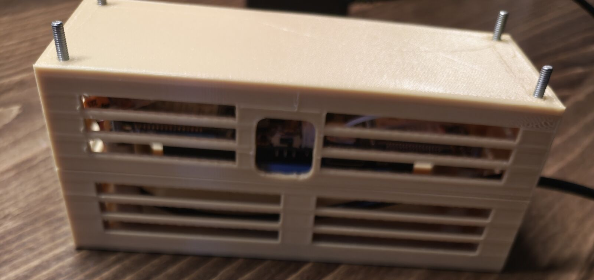
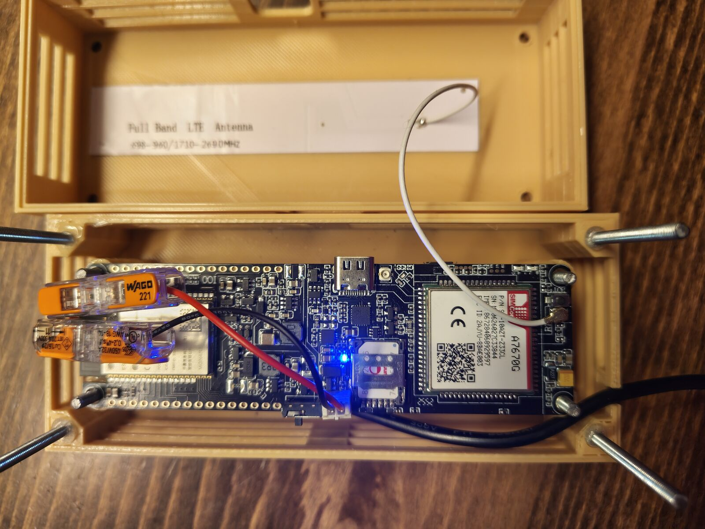
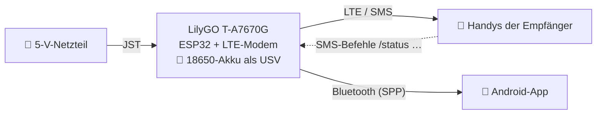
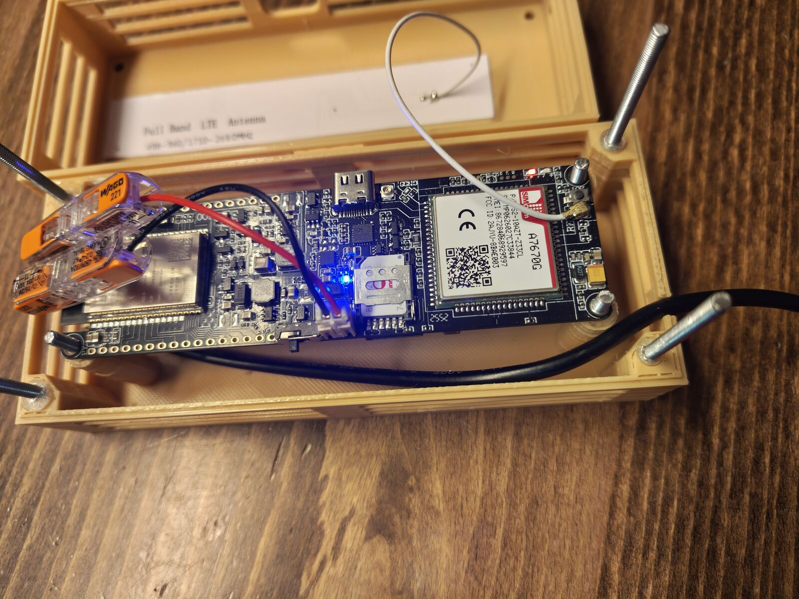
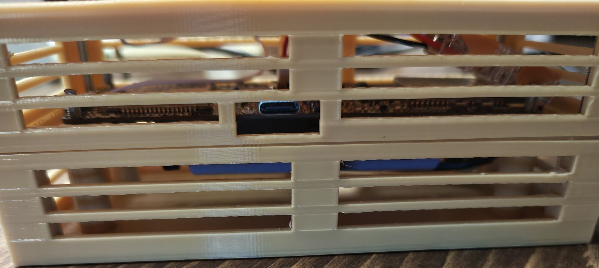

<div align="center">

# ⚡ LilyGO-Netzwächter

**Stromausfall-Melder mit SMS-Alarm, Akku-Puffer und Android-App**

[](https://github.com/Lukas0923xcv/esp32/actions/workflows/build-apk.yml)
[](https://github.com/Lukas0923xcv/esp32/releases/tag/latest)





</div>

Fällt der Netzstrom aus, schickt der Netzwächter eine **SMS** an bis zu fünf Nummern und meldet sich
wieder, sobald der Strom zurück ist. Ein **18650-Akku** hält ihn währenddessen am Laufen. Eine
**Android-App** zeigt den Live-Status per Bluetooth und dient zum Einstellen; unterwegs lässt er sich
auch **per SMS-Befehl** abfragen und konfigurieren.

| | |
|---|---|
| 📩 **SMS-Alarm** | Bei Ausfall, bei Wiederkehr und optional bei schwachem Akku – an bis zu 5 Empfänger |
| 🔋 **Läuft weiter** | Der eingebaute 18650-Akku puffert das Board während des Ausfalls |
| 📱 **Android-App** | Live-Status, Diagnose, Event-Log, Benachrichtigung, alle Einstellungen, Demo-Modus |
| 💬 **SMS-Fernsteuerung** | `/status`, `/pause 2h`, `/nummer neu …` – von überall, ohne App |
| 🛡️ **Keine Fehlalarme** | Hysterese, Entprellung und einstellbare Alarm-Verzögerung |

## Inhalt

- [So funktioniert es](#so-funktioniert-es)
- [Hardware & Gehäuse](#hardware--gehäuse)
- [Inbetriebnahme](#inbetriebnahme)
  - [1. Firmware flashen](#1-firmware-flashen)
  - [2. Android-App](#2-android-app)
  - [3. Per SMS steuern](#3-per-sms-steuern)
- [Projektstruktur](#projektstruktur)
- [Weitere Dokumentation](#weitere-dokumentation)

## So funktioniert es



- Das Board hängt an einem 5-V-Netzteil am **JST-Eingang** (beim Board als Solar-Eingang bezeichnet,
  ADC-Pin 36). Diese Spannung ist der Sensor für den Netzstrom.
- Fällt sie unter **2,5 V** (gemessen hinter dem Spannungsteiler), gilt der Strom als weg, ab **3,0 V**
  wieder als da – mit Hysterese und Entprellung gegen Flackern.
- Bleibt der Strom länger als die **Alarm-Verzögerung** weg (Standard 3 min), geht die Alarm-SMS raus.
  Ist er wieder stabil da (Standard 10 s), folgt die Entwarnung. Optional warnt er, wenn der Akku
  während eines Ausfalls unter eine Schwelle fällt.
- Das Modem läuft in einem eigenen Task auf Core 0, damit Bluetooth und App nie hängen.
- Alle Einstellungen liegen im Flash des ESP32 und überleben einen Neustart.

## Hardware & Gehäuse

| Teil | Zweck |
|---|---|
| LilyGO **T-A7670G R2** | ESP32, LTE-Modem SIMCom A7670G, Akku-Halter auf der Rückseite |
| **18650-Akku** | Puffer während des Stromausfalls |
| **5-V-Netzteil** am JST-Eingang | Versorgung *und* Sensor für den Netzstrom |
| **Nano-SIM** mit SMS-Guthaben | Für Alarm-SMS und SMS-Befehle |
| Flache **LTE-Antenne** (698–960 / 1710–2690 MHz) | Klebt innen im Deckel, per IPEX am Modem |
| 2 × **WAGO 221** | Verbinden Netzteil-Kabel und JST-Stecker ohne Löten |
| 3D-gedrucktes **Gehäuse** | Zwei Hälften mit Lüftungsschlitzen, von 4 Gewindestangen zusammengehalten |

<p align="center">
  
  
</p>

Aufbau, alle Fotos und Hinweise zum Gehäuse: **[docs/HARDWARE.md](docs/HARDWARE.md)**

> [!NOTE]
> Die Firmware ist auf die Schweiz zugeschnitten: Die SMS-Zentrale ist fest auf **Sunrise**
> (`SMSC = "+41794999000"`) eingestellt, und Nummern ohne Ländervorwahl (`079…`) werden als `+41…`
> gelesen. Bei einem anderen Anbieter oder Land beides oben in `netzwaechter.ino` anpassen.

## Inbetriebnahme

### 1. Firmware flashen

1. Arduino IDE mit dem Board-Paket **esp32 by Espressif** installieren.
2. Im Ordner `esp32-firmware/netzwaechter/` die Vorlage kopieren und ausfüllen:

   ```sh
   cp secrets.example.h secrets.h
   ```

   ```c
   #define SMS_TARGET_NUMBER "+41790000000"   // Standard-Empfänger und Admin-Nummer
   #define SIM_PIN           "0000"           // PIN der SIM, leer lassen wenn keine PIN
   ```

   `secrets.h` ist in `.gitignore` und landet nicht auf GitHub. Die **Admin-Nummer** darf immer
   SMS-Befehle schicken, damit du dich nicht aussperren kannst. Die SIM-PIN wird beim ersten Start
   deaktiviert. Ohne `secrets.h` lässt sich der Sketch trotzdem bauen, dann aber ohne Admin-Nummer
   und ohne PIN.
3. `netzwaechter.ino` öffnen, das Board auswählen (LilyGO empfiehlt für die T-A76xx-Serie
   *ESP32 Wrover Module*) und hochladen. Meldet die IDE, dass der Sketch zu groß ist, ein
   Partitionsschema mit mehr Platz für die App wählen (z. B. *Huge APP*), denn Bluetooth Classic
   braucht viel Flash.
4. Im seriellen Monitor (115200 Baud) siehst du, ob Modem und SIM bereit sind.

### 2. Android-App

**Fertige APK:** [Releases → latest → `app-release.apk`](https://github.com/Lukas0923xcv/esp32/releases/tag/latest)
– wird bei jedem Push auf `main` automatisch neu gebaut.

1. Unter Android den Netzwächter (`LilyGO-Netzwaechter`) in den Bluetooth-Einstellungen koppeln.
2. App öffnen, Berechtigungen (Bluetooth, Standort, Benachrichtigungen) erlauben, Gerät wählen, **Verbinden**.
3. Unter **SMS-Alarm einstellen** Empfänger, Texte, Verzögerungen und die Akku-Warnung setzen.

Die App zeigt Netzstatus, Netzteil-Spannung, Akkustand, SMS-Status, eine Diagnose und ein Event-Log
der Statuswechsel. Bei einem Ausfall gibt es zusätzlich eine Benachrichtigung auf dem Handy, solange
es verbunden ist. Mit dem **Demo-Modus** lässt sich die App ohne Hardware ausprobieren.

<details>
<summary><b>App selbst bauen</b> (Flutter 3, Java 17)</summary>

```sh
cd android-app
flutter pub get
flutter build apk --release
```

`flutter_bluetooth_serial` muss mit neueren Android-Gradle-Plugins gepatcht werden (Namespace und
`compileSdkVersion`); wie, steht im Workflow
[`.github/workflows/build-apk.yml`](.github/workflows/build-apk.yml). Ohne das Secret `KEYSTORE_BASE64`
wird die APK mit dem Debug-Schlüssel signiert.

</details>

### 3. Per SMS steuern

Eine SMS, die mit `/` beginnt, ist ein Befehl, zum Beispiel `/status`, `/alarm 10m`, `/pause 3h`
oder `/nummer neu +41781234567`. Antworten kommen nach 15–30 Sekunden. Befehle werden nur von
eingetragenen Empfängern und der Admin-Nummer angenommen.

Alle Befehle: **[docs/SMS-BEFEHLE.md](docs/SMS-BEFEHLE.md)**

> [!WARNING]
> Der Netzwächter prüft nur die Absender-Nummer, und die lässt sich fälschen. Wer das nicht will,
> schaltet die SMS-Steuerung in der App ab (**SMS-Alarm → Fernsteuerung per SMS**).

## Projektstruktur

```
.
├── esp32-firmware/
│   └── netzwaechter/
│       ├── netzwaechter.ino       Firmware (Arduino-Sketch)
│       └── secrets.example.h      Vorlage für Admin-Nummer und SIM-PIN
├── android-app/                   Flutter-App (Dashboard, SMS-Einstellungen, Event-Log)
│   └── lib/
├── docs/
│   ├── HARDWARE.md                Aufbau, Gehäuse, Fotos
│   ├── SMS-BEFEHLE.md             Alle SMS-Befehle, Zeitangaben, Platzhalter
│   ├── BLUETOOTH-PROTOKOLL.md     Statuszeile und Befehle zwischen App und Board
│   └── images/                    Fotos
└── .github/workflows/
    └── build-apk.yml              Baut die APK bei jedem Push auf main
```

## Weitere Dokumentation

| Dokument | Inhalt |
|---|---|
| [Hardware & Aufbau](docs/HARDWARE.md) | Teileliste, Verkabelung, Gehäuse, Fotogalerie |
| [SMS-Befehle](docs/SMS-BEFEHLE.md) | Fernsteuerung per SMS, Zeitangaben, Platzhalter |
| [Bluetooth-Protokoll](docs/BLUETOOTH-PROTOKOLL.md) | Für eigene Apps oder Skripte, die mit dem Board reden |
| [Firmware](esp32-firmware/README.md) | Pins, Schwellwerte und wo man sie ändert |
| [Android-App](android-app/README.md) | Aufbau der Flutter-App |
