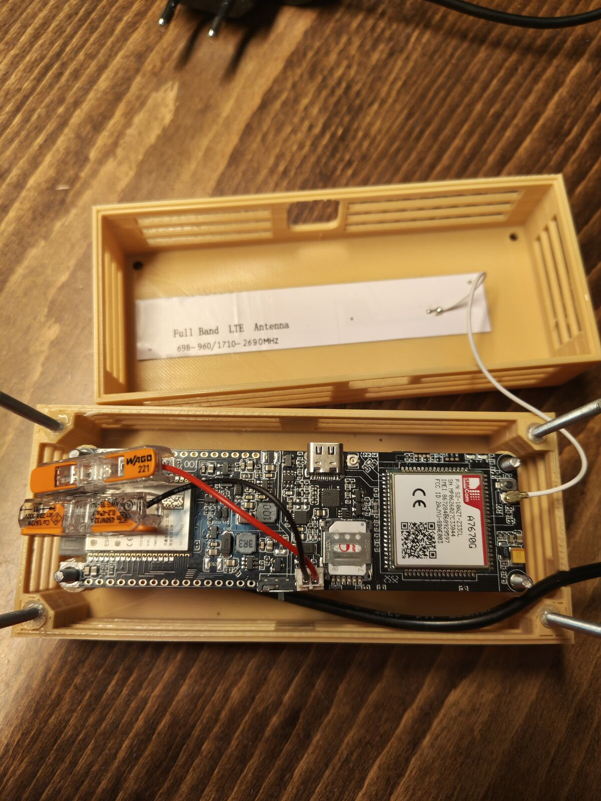
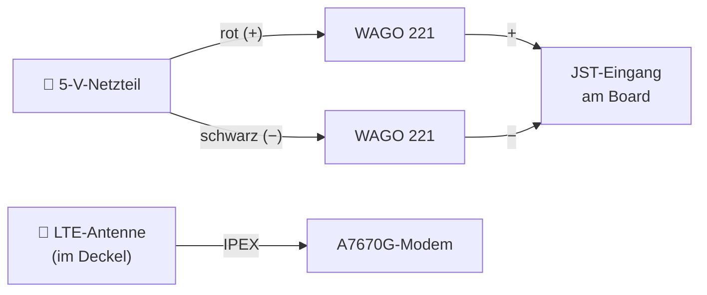
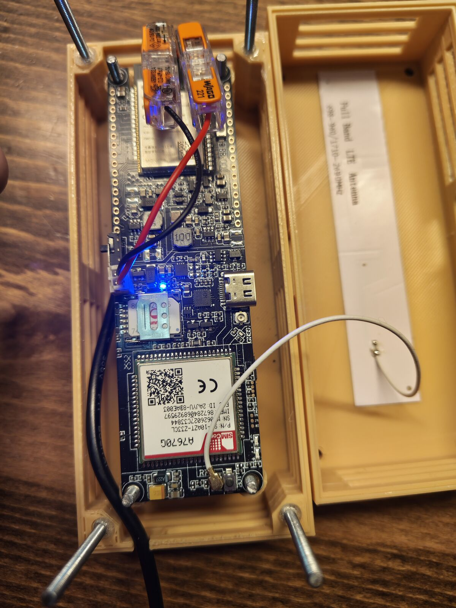
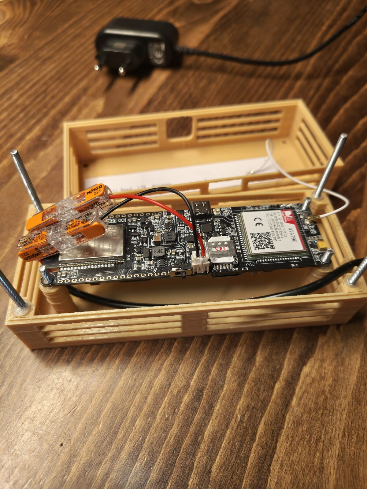
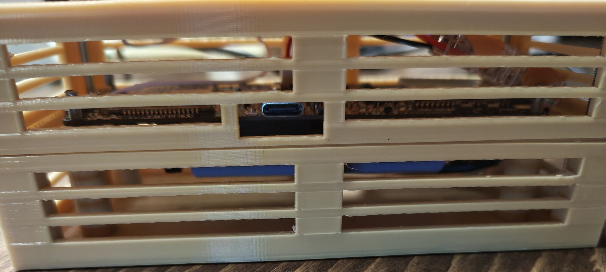
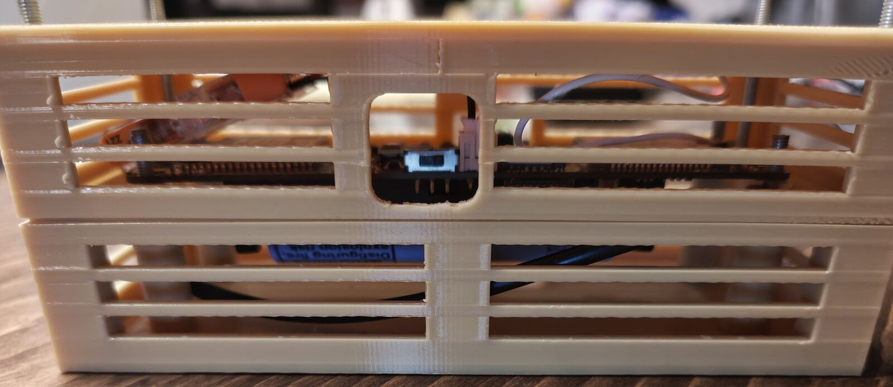
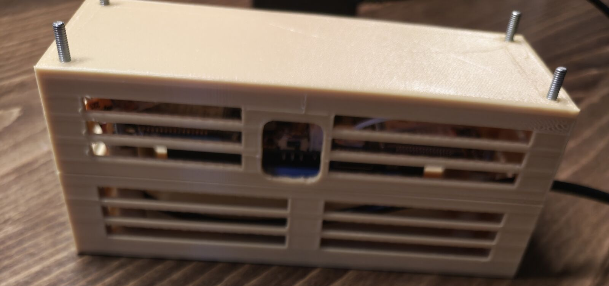
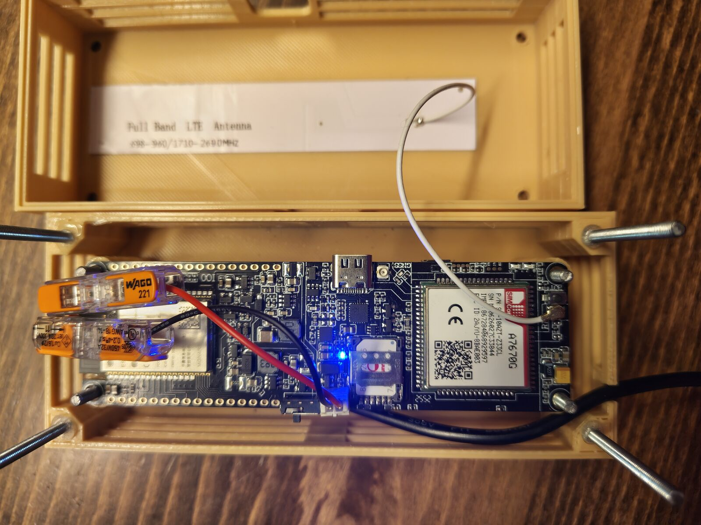
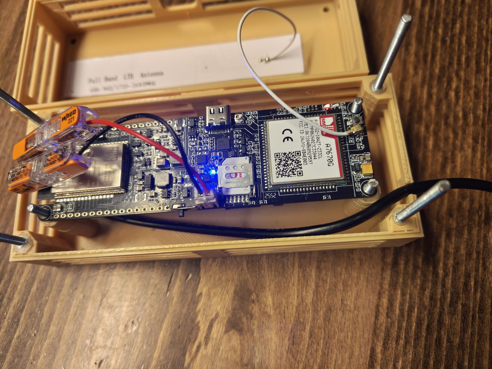

# Hardware & Aufbau

← [Zurück zur Übersicht](../README.md)

  

## Teileliste

| Teil | Hinweis |
|---|---|
| LilyGO **T-A7670G R2** | ESP32 + LTE-Modem SIMCom A7670G; Akku-Halter auf der Rückseite |
| **18650-Akku** | Sitzt im Halter unter dem Board und puffert bei Stromausfall |
| **5-V-Netzteil** | Hängt am JST-Eingang (beim Board „Solar“, ADC-Pin 36) – Versorgung und Sensor zugleich |
| **Nano-SIM** | Mit SMS-Guthaben; PIN in `secrets.h` eintragen oder vorher deaktivieren |
| Flache **LTE-Antenne** | Full Band, 698–960 / 1710–2690 MHz, mit IPEX-Stecker |
| 2 × **WAGO 221** | Verbinden Netzteil-Kabel und JST-Kabel (Plus / Minus) |
| 3D-gedrucktes **Gehäuse** | Unter- und Oberteil mit Lüftungsschlitzen |
| 4 × **Gewindestange** + Muttern | Halten Board-Abstandshalter und die beiden Gehäusehälften zusammen |

## Verkabelung

1. Netzteil-Kabel und das Kabel des JST-Steckers je mit einer **WAGO 221** verbinden – rot an rot,
   schwarz an schwarz. **Polarität vor dem Einstecken mit einem Messgerät prüfen.**
2. JST-Stecker in den Eingang neben dem SIM-Halter stecken.
3. Antenne mit dem **IPEX-Stecker** am Modem (Anschluss neben dem A7670G) aufstecken und die flache
   Antenne innen auf den Deckel kleben – möglichst weit weg vom Board.
4. Nano-SIM einlegen, 18650-Akku einsetzen, Schiebeschalter einschalten.

  
  

## Gehäuse

- **Zwei Hälften:** Das Unterteil nimmt Board und Akku auf, das Oberteil trägt die Antenne. Vier lange
  Gewindestangen laufen durch die Ecken und halten alles zusammen.
- **Board auf Abstandshaltern:** Es sitzt erhöht über dem Boden, damit der 18650-Akku auf der
  Rückseite Platz hat und Luft zirkuliert.
- **Lüftungsschlitze** rundum: Modem und Laderegler werden beim Senden und Laden warm.
- **Aussparungen** auf den Längsseiten für den **USB-C-Anschluss** (Flashen, Laden) und den
  **Ein/Aus-Schalter** – beide sind bei geschlossenem Gehäuse erreichbar.
- Das Netzteil-Kabel wird seitlich durch einen Lüftungsschlitz geführt.

  
  

## Fotogalerie

| | |
|---|---|
|  |  |
| *Geschlossen, mit Gewindestangen* | *Geöffnet: Board, WAGO-Klemmen, Antenne im Deckel* |
|  |  |
| *Board über dem Akku auf Abstandshaltern* | *USB-C-Aussparung* |

## Tipps

- **Empfang prüfen**, bevor das Gehäuse zu ist: `/status` per SMS schicken – die Antwort enthält die
  Signalstärke. Bei schlechtem Empfang die Antenne anders ausrichten oder den Standort wechseln.
- Den Netzwächter an eine Steckdose hängen, die **am selben Stromkreis** hängt wie das, was überwacht
  werden soll (z. B. Tiefkühler, Heizung, Pumpe).
- Ein schwacher oder alter Akku verkürzt die Laufzeit bei Ausfall – die Akku-Warnung in der App
  (`/akku 20`) sagt rechtzeitig Bescheid.
